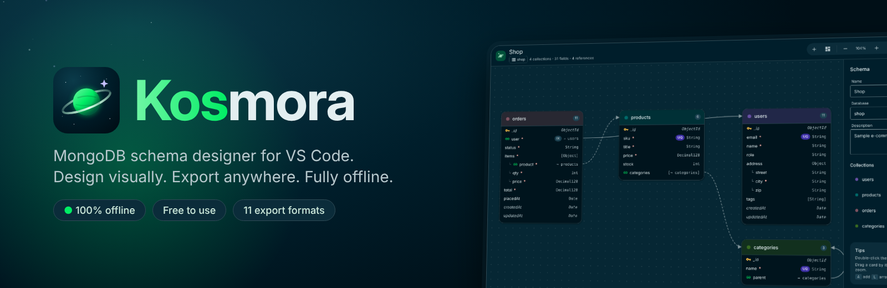
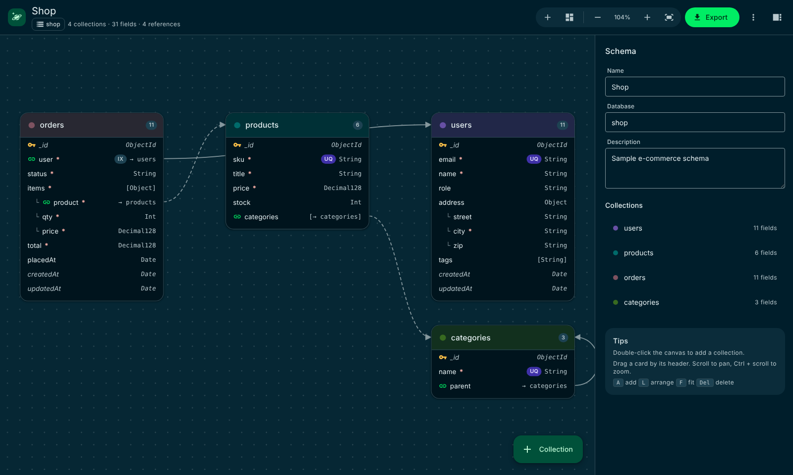
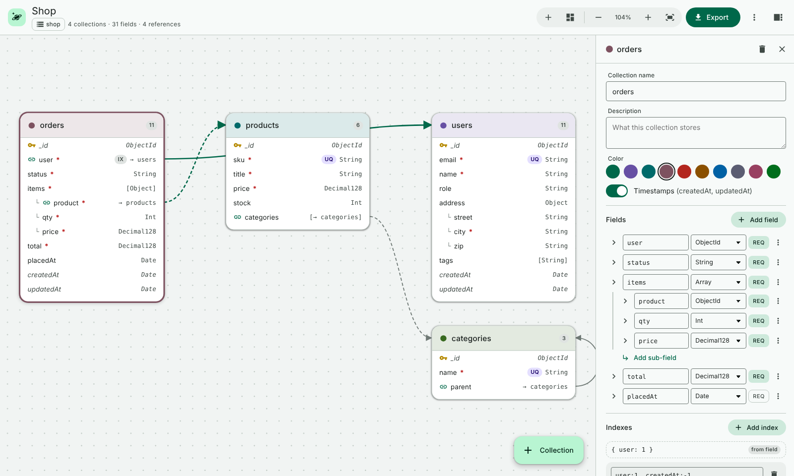
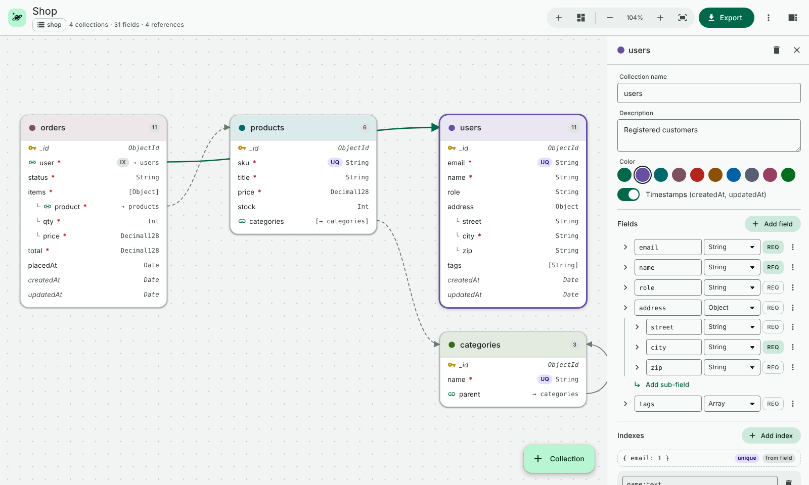
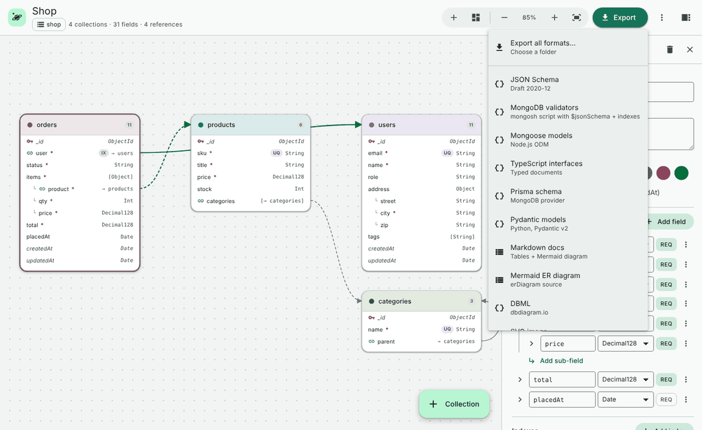
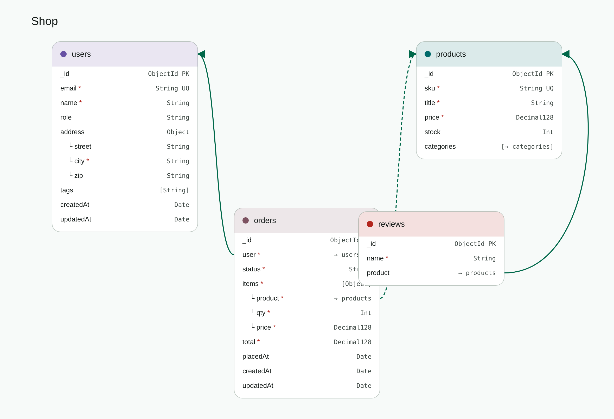

<p align="center"></p>

<p align="center">
  <a href="https://marketplace.visualstudio.com/items?itemName=sanket-manohar.kosmora"><b>Install from Marketplace</b></a> ·
  <a href="https://github.com/sanket-manohar/kosmora/releases/latest">Download .vsix</a> ·
  <a href="https://sanket-manohar.github.io/kosmora/">Website</a> ·
  <a href="https://sanket-manohar.github.io/kosmora/guide.html">User guide</a> ·
  <a href="docs/Kosmora-User-Manual.pdf">PDF manual</a>
</p>

# Kosmora

**Kosmora** is a MongoDB schema designer for Visual Studio Code. Draw your data model on a canvas and export it to the code you need. It's free to use, works completely offline and never connects to a database.



## Features

### 🪐 Visual schema designer
- Drag-and-drop canvas with collections, nested objects, arrays and references
- Every detail in one panel: types, required, unique, indexes, enums, defaults, ranges, patterns and descriptions
- Live problem checking, auto-arrange, zoom and keyboard shortcuts
- Designs are plain `.kosmora.json` files that work well in Git

### 📦 Export to 11 formats
JSON Schema · MongoDB validators · Mongoose · TypeScript · Prisma · Pydantic · Markdown · Mermaid · DBML · SVG · PNG

### 🗂️ All your designs in one place
- The **Schema Designs** view in the activity bar lists every design in your workspace
- A built-in walkthrough gets you from a blank canvas to exported code in a few minutes

### 🔒 Private and offline
No telemetry, no accounts, no internet and no database connection. Kosmora only reads and writes the design files you open and the export files you create.

## Screenshots

| Designer (light) | Field inspector |
| --- | --- |
|  |  |
| **Export menu** | **Exported diagram** |
|  |  |

## Install

**From the Marketplace:** open the Extensions view in VS Code (`Ctrl+Shift+X`), search for **Kosmora** and click **Install**.

**Offline:** download `kosmora-1.0.0.vsix` from [Releases](https://github.com/sanket-manohar/kosmora/releases/latest), then in the Extensions view choose **⋯ → Install from VSIX…**, or run:

```bash
code --install-extension kosmora-1.0.0.vsix
```

You need VS Code 1.85 or newer. No MongoDB server is needed.

## Quick start

1. Follow the built-in walkthrough, which opens after you install. You can reopen it any time with **Kosmora: Get Started with Kosmora**.
2. Or open the Command Palette (`Ctrl+Shift+P`) and run **Kosmora: New Sample Schema (Shop)**.
3. Click a collection to edit it in the panel on the right.
4. Click **Export** and pick a format.
5. Click the planet icon in the activity bar to see all your designs.

Read the full [user guide](https://sanket-manohar.github.io/kosmora/guide.html), or download the [PDF manual](docs/Kosmora-User-Manual.pdf).

## Support

Found a bug or have an idea? [Open an issue](https://github.com/sanket-manohar/kosmora/issues/new/choose).

## License

Kosmora is **proprietary software**. It is free to download and use for personal, educational and commercial work. You may not republish, redistribute, modify, update or sell it. See [LICENSE.md](LICENSE.md) for the full terms.

This repository holds Kosmora's releases, documentation and website. The source code is not public.

© 2026 Sanket Santosh Vidya Manohar. All rights reserved.

## Your data and responsibility

Kosmora never connects to a database. It only reads and writes the design files you open and the export files you create, so what you do with the generated code and scripts is up to you.

- Review generated output, and test any generated script on a non-production copy, before you use it on real data.
- Kosmora is provided "as is", without warranty. Its owner accepts no liability for data loss, corruption, downtime or any other damage from using it or its output. See section 6 of [LICENSE.md](LICENSE.md).

## Trademarks

Kosmora is independent software. It is not affiliated with, endorsed by or connected to MongoDB, Inc., Microsoft or any other company whose products it designs for or exports to. MongoDB, Visual Studio Code and other names are trademarks of their respective owners and are used only to describe compatibility. See section 10 of [LICENSE.md](LICENSE.md).
